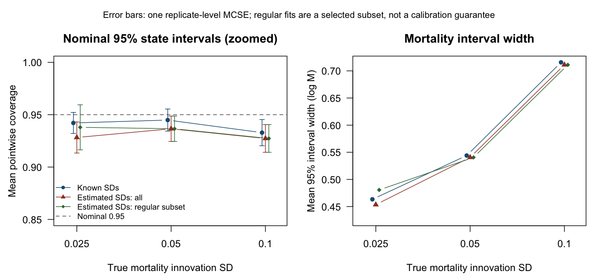

# Replicated interval calibration and mortality-SD sensitivity

Run from the repository root:

```sh
Rscript tests/integration/process-recovery/run-calibration.R /tmp/fims-process-calibration 10 18
Rscript tests/integration/process-recovery/plot-calibration.R /tmp/fims-process-calibration
```

Base revision: `a91bc36`. Configuration, numerical-source checksums and session
versions are retained in `configuration.R`. Existing pilot sources/artifacts
are unchanged. The local FIMS production build is unchanged through `053646a`,
using R 4.4.3/TMB 1.9.20 on Apple ARM64.

This run generated ten 18-year datasets each at true mortality innovation SDs
0.025, 0.05 and 0.10. Survey log-SD is 0.05 and age/length composition sample
size is 2000. Proper-normal initial uncertainty is retained; other biology and
observation parameters are known. Each dataset compares all innovation SDs
fixed at truth against all three estimated, so differences are not solely the
effect of estimating mortality SD. Estimated fits use common SD starts 0.05
and 0.20. Process innovations are standardized/paired across true-SD settings;
biological trajectories and observation probabilities change with mortality.

## Execution and diagnostics

All 60 uncertainty reports succeeded without exceptions, with positive reported
Hessians and valid optimizer/inner-mode checks. Of 60 covariance optimizer
starting-point attempts, 58 met the declared checks; every estimated fit had a
valid selected start. Rebuilding selected covariance points before `sdreport`
changed objectives by at most 0.0000000021 NLL units. All attempts remain in
`attempts.csv`; missing/failed cases are not substituted with good intervals.

Five of ten estimated fits at true M SD 0.025 reached its lower bound (0.001).
No covariance boundaries occurred at true SDs 0.05 or 0.10. Thus 55 of 60
known/estimated reports met the regular reporting rule. Regularity checks are
necessary diagnostics, not a guarantee of unique solutions or valid intervals.

## Mortality state intervals

The table averages pointwise 95% log-M interval coverage within each replicate,
then across ten replicates. MCSEs are **percentage points**, calculated from
replicate coverage fractions, not independent age-year trials.

| True M SD | Known-SD coverage | MCSE | Estimated-SD coverage, all fits | MCSE | Estimated-SD boundaries |
|---|---:|---:|---:|---:|---:|
| 0.025 | 94.21% | 1.01 | 92.82% | 1.49 | 5/10 |
| 0.050 | 94.49% | 1.06 | 93.66% | 1.21 | 0/10 |
| 0.100 | 93.29% | 1.25 | 92.73% | 1.32 | 0/10 |

Paired estimated-minus-known coverage differences were -1.39, -0.83 and -0.56
percentage points, with MCSEs 0.87, 0.89 and 0.56 respectively. These differences
are modest relative to their Monte Carlo uncertainty. Ten replicates do not
establish either nominal calibration or a definitive departure from it.



The coverage panel is zoomed, with error bars of one MCSE rather than confidence
intervals. The regular-only estimated curve is a selected subset, not an
unconditional performance measure. At true SD 0.025, its five regular fits had
93.80% coverage, while the five boundary fits had 91.85%. This selection must
not hide the latter cases. Mean log-M interval widths, known versus estimated,
were 0.463/0.453, 0.544/0.541 and 0.716/0.711 across the three true-SD settings.
Proper initial uncertainty helps keep state intervals nonzero even when
innovation variance collapses; this does not make the covariance estimate reliable.

These are joint-generative fitted-state uncertainty checks with correctly
specified priors/likelihoods. R intervals score recruitment log-deviations, F
intervals log-F and M intervals log-M. Actual recruit totals, forecasts,
spawning-biomass uncertainty and simultaneous all-cell coverage are not tested.

## Mortality SD recovery and intervals

Mean estimated M SDs were 0.0150, 0.0465 and 0.0972 at truths 0.025, 0.05 and
0.10. The smallest true SD remains the weak-variance case in this run.
Log-SD Wald intervals covered truth in 9/10, 10/10 and 10/10 estimated fits.
Their exact binomial uncertainty limits on apparent coverage were approximately
[0.555, 0.997], [0.692, 1] and [0.692, 1]. These are uncertainty limits for the
coverage proportion, not confidence limits for the process SD.

All five boundary fits at true SD 0.025 nominally covered its true SD, reflecting
very wide log-SD uncertainty. This is not evidence that boundary Wald inference
is regular. Among the five interior fits, coverage was 4/5, with a very wide
coverage uncertainty interval. Raw intervals and regular/nonregular summaries
are retained rather than reporting apparent 100% coverage as validation.

## Validation and limits

The benchmark tests passed 17 tests / 114 assertions, including all four opt-in
integration checks. Tests cover interval widths/scoring, replicate-level MCSEs,
boundary/failure accounting, covariance-point rebuilds, SD-sensitive paired
innovations and actual uncertainty estimation. The plot and paired-difference
postprocessor were exercised, and the final PNG was visually inspected.
Numerical-source checksums and result denominators were verified. No production
code, dependencies or previous pilot sources changed.

Measured covariance-start fits totaled 302.838 seconds; uncertainty rebuilding,
evaluation and `sdreport` totaled 625.690 seconds. These exclude operating model
simulation, garbage collection, checkpoint/output writing and plotting. No
large-model scalability conclusion is drawn.

This is stronger screening evidence than a three-replicate recovery check, but
it remains ten replicates per setting with known biology and informative,
independent multinomial observations. More replication, misspecification,
composition overdispersion, aging error and unknown biology remain necessary
before operational use. In particular, first-year information and small process
SDs need explicit sensitivity analysis; adding covariance structure is not a
substitute for that validation.

Compact tables retain every covariance start, fit diagnostics, per-replicate
metrics, hyperparameters, summaries and paired differences. Full pointwise state
estimates, truth, generated data and checkpoints are regenerated in RDS/CSV
outputs and are not committed as large/binary artifacts.
