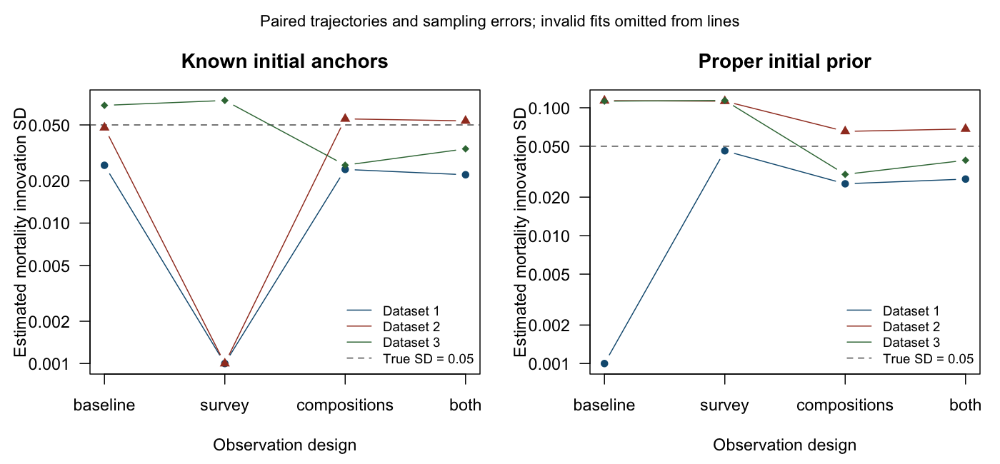
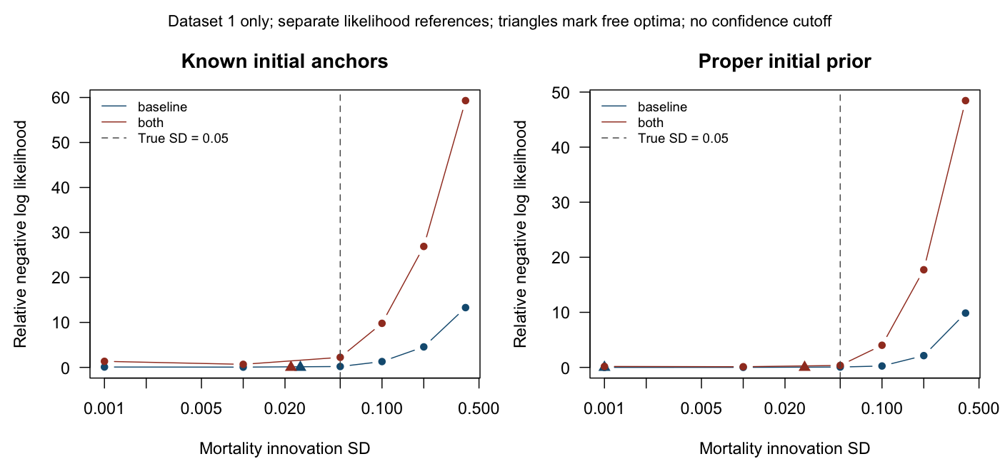

# Paired observation-information pilot

Run from the repository root:

```sh
Rscript tests/integration/process-recovery/run-information.R /tmp/fims-observation-information 3 18
Rscript tests/integration/process-recovery/plot-information.R /tmp/fims-observation-information
```

Base revision: `50b323e`. Configuration, session and numerical-source checksums
are retained in `configuration.R`. The original two pilot sources and their
artifacts remain unchanged. The same local FIMS production build (through
`053646a`), R 4.4.3 and TMB 1.9.20 on Apple ARM64 were used.

Three 18-year latent trajectories are shared exactly across four designs:
baseline survey log-SD 0.20/composition size 200; survey log-SD 0.05 only;
composition size 2000 only; and both improvements. Catch log-SD remains 0.1.
Survey errors are paired on their standard-normal scale, and larger composition
samples contain the smaller samples as prefixes of categorical pools. These
observations differ from earlier pilots, so design effects must be assessed
within this experiment. All designs use their matching likelihood formulas.

Each joint recruitment/F/M fit uses common SD starts 0.05 and 0.2, with known
initial anchors or proper initial priors. Baseline and combined designs also
receive six-point mortality-SD profiles for dataset 1. Nuisance covariance
parameters and all latent states are reoptimized at every point and start.

## Results

All 96 optimizer attempts returned finite results without caught exceptions.
94 passed the declared checks; two exceeded the 0.001 projected-gradient
threshold despite optimizer code zero. All 48 selected free/profile cases had
at least one valid start; 46 had both. The maximum objective spread among valid
starts was below 0.000000016 NLL units. Invalid attempts remain in `attempts.csv`.

The true M innovation SD is 0.05. Means below include all three valid free fits
per design/initial-information setting:

| Initial information | Design | Mean M SD | Mean log-M state RMSE | M-SD lower-bound fits |
|---|---|---:|---:|---:|
| Known anchors | baseline | 0.0475 | 0.1199 | 0/3 |
| Known anchors | survey | 0.0256 | 0.1230 | 2/3 |
| Known anchors | compositions | 0.0351 | 0.1171 | 0/3 |
| Known anchors | both | 0.0364 | 0.1140 | 0/3 |
| Proper prior | baseline | 0.0757 | 0.2319 | 1/3 |
| Proper prior | survey | 0.0909 | 0.2260 | 0/3 |
| Proper prior | compositions | 0.0403 | 0.1839 | 0/3 |
| Proper prior | both | 0.0449 | 0.1776 | 0/3 |



Within the proper-initial setting, larger compositions reduced mean log-M state
RMSE by about 21%, and the combined design by about 23%; both improved state
RMSE in all three paired datasets. Survey precision alone reduced mean RMSE by
about 3%. With known anchors, the corresponding composition/combined changes
were about 2%/5%, and survey precision alone slightly increased mean RMSE.
Known-anchor fits score 204 estimated mortality states; proper-initial fits
score 216, including first-year uncertainty. Compare designs within each setting,
not their absolute RMSEs as if their information/scored states were identical.

State recovery and variance recovery are distinct. Improving survey precision
alone moved two known-anchor fits to the lower bound, while the combined design
avoided lower-bound M SDs here. This is not evidence that better survey precision
systematically harms inference or that larger samples guarantee variance recovery.
Three paired replicates cannot estimate reliable boundary frequencies or bias.

For dataset 1, relative NLL values were:

| Initial information | Design | Best free M SD | NLL difference at 0.001 | NLL difference at true SD 0.05 |
|---|---|---:|---:|---:|
| Known anchors | baseline | 0.0258 | 0.083 | 0.197 |
| Known anchors | both | 0.0221 | 1.347 | 2.234 |
| Proper prior | baseline | 0.0010 | 0.000 | 0.062 |
| Proper prior | both | 0.0277 | 0.170 | 0.355 |



Combined observations sharpened relative support against large SDs and, with
known anchors, against the lower bound. However, the sharper profile favored an
SD below truth in this replicate. Stronger information and more curvature must
not be presented as demonstrated calibration. Each curve has its own dataset
and initial-information likelihood reference; raw objectives are not compared.
No confidence cutoff, interval coverage or Hessian qualification is computed.

Median fit time was 4.472 seconds (maximum 5.562); summed measured fit time was
434.8 seconds. Timings include initialization, optimization and latent-mode
checks, excluding simulation/pool generation, GC, writing, plotting and uncertainty
calculations. Maximum latent dimension was 251. No general scaling claim follows.

Validation passed 13 tests / 83 assertions, including all three opt-in benchmark
integration checks. Tests cover paired truth/catch observations, standardized
survey errors, nested count samples, matching likelihood specifications, RNG
restoration, per-dataset profile references, and retention of all-invalid groups.
Both PNGs were rendered and visually inspected. No production code or new
dependencies were introduced.

Next: use more replicates to check interval calibration and process-SD sensitivity
under informative composition designs before selecting a more complex mortality
covariance. A scientifically motivated lower-dimensional mortality process may
also merit comparison, but this pilot does not establish which structure is
biologically appropriate. Known biology, independent multinomial samples and no
aging error/overdispersion make these optimistic screening cases, not an
operational data-collection recommendation.

The compact CSVs preserve every attempt, selected case and summary denominator.
Full truth, datasets, predictions, error pools and checkpoints are regenerated
as RDS files in the output directory; those binaries are not committed.
