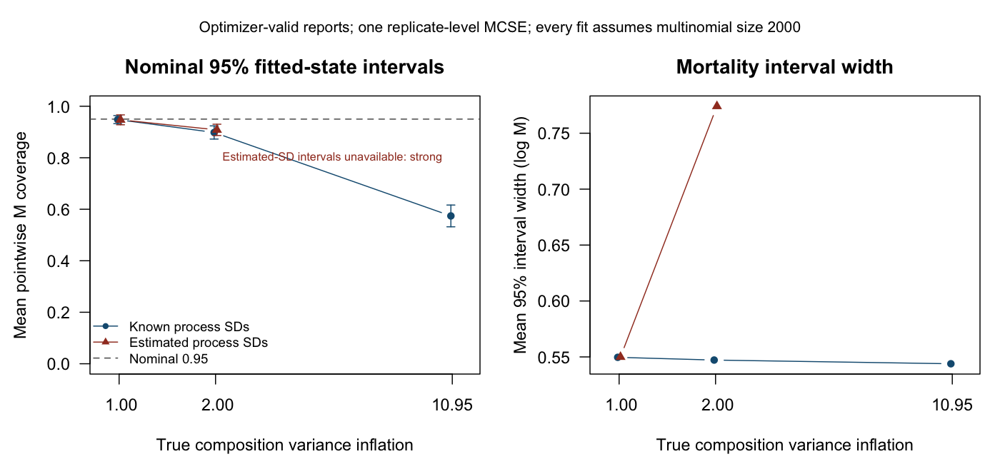

# Composition-overdispersion misspecification pilot

```sh
Rscript tests/integration/process-recovery/run-robustness.R /tmp/fims-composition-robustness 5 18
Rscript tests/integration/process-recovery/plot-robustness.R /tmp/fims-composition-robustness
Rscript tests/integration/process-recovery/diagnose-robustness.R /tmp/fims-composition-robustness
```

Run from the repository root. Base revision: `1b54c03`. Configuration, numerical
source checksums and session information are in `configuration.R`; prior sources
and pilots remain unchanged. The same FIMS production build, R 4.4.3/TMB 1.9.20
on Apple ARM64 was used. No production likelihood or dependency was added.

Five 18-year latent trajectories each receive three paired observation datasets.
Catch/survey values are identical across scenarios, with survey log-SD 0.05 and
catch log-SD 0.1. True recruitment/F/M innovation SDs are 0.20/0.15/0.05 and
proper-normal initial uncertainty is retained. Each composition observation uses
`q ~ Dirichlet(kappa*p)` followed by multinomial sampling of 2000 individuals;
the control fixes `q=p`. Independent gamma-quantile uniforms and categorical
uniforms are shared across concentration settings, preserving each scenario's
marginal law. Structural-zero bins remain zero. Observation groups remain
independent; this does not add time-correlated errors or aging error.

| Generator | Concentration kappa | Variance inflation | Moment-matched effective n |
|---|---:|---:|---:|
| Multinomial control | infinity | 1.00 | 2000 |
| Moderate extra variation | 2000 | 2.00 | 1000.5 |
| Strong extra variation | 200 | 10.95 | 182.7 |

Every fitted likelihood remains multinomial at nominal n=2000. Effective n is
an analytical descriptor, not a weight supplied to the model. This is intentional
observation-model misspecification in the finite-concentration cases. The
hierarchy is generic; [Stock Synthesis documents Dirichlet–multinomial composition options](https://nmfs-ost.github.io/ss3-doc/SS330_User_Manual_release.html),
but this does not implement its parameter interface or a FIMS production density.

## State uncertainty and recovery

| Generator | Process SDs | Optimizer-valid reports / planned | Mean M coverage | Coverage MCSE (percentage points) | Mean log-M RMSE | Mean log-M interval width |
|---|---|---:|---:|---:|---:|---:|
| Control | Known | 5/5 | 94.81% | 1.56 | 0.160 | 0.550 |
| Control | Estimated | 5/5 | 94.72% | 1.92 | 0.161 | 0.550 |
| Moderate | Known | 5/5 | 89.81% | 2.56 | 0.180 | 0.547 |
| Moderate | Estimated | 5/5 | 90.83% | 2.19 | 0.218 | 0.774 |
| Strong | Known | 5/5 | 57.41% | 4.23 | 0.339 | 0.544 |
| Strong | Estimated | 0/5 | unavailable | unavailable | unavailable | unavailable |



Known-SD coverage differences from the control were -5.0 and -37.4 percentage
points, with paired MCSEs 2.11 and 5.15 points for moderate/strong scenarios.
The corresponding moderate estimated-SD difference was -3.89 points (MCSE 0.99).
These are five-replicate screening results, not operational boundary/coverage
frequency estimates. The stress effect is not a failure to recover an exactly
specified observation model: that model is deliberately wrong here.

With known process SDs, interval widths stayed nearly unchanged while state
error grew. Allowing SD estimation widened moderate-case intervals but did not
restore nominal coverage or improve state RMSE. Mean fitted mortality SD rose
from about 0.0476 in the control to 0.1195 under moderate extra variation, against
truth 0.05. The fit can attribute observation variation to biological variation.
A positive Hessian and small gradients did not detect this misspecification.

## Strong-case numerical outcomes remain visible

All 30 covariance-start attempts returned values; 24 passed the declared checks.
Fourteen of fifteen estimated cases had a valid selected start; both starts
failed the projected-gradient threshold in strong-case replicate 4. All five
strong-case selected outcomes reached the declared M-SD upper bound of 1.0,
including that invalid case. This is a benchmark bound, not an inferred physical
upper limit on mortality or evidence of a well-determined variance.

There were 30 planned uncertainty reports. Four strong estimated cases failed
the covariance-point cold-rebuild objective check, so no intervals were produced.
The fifth produced numerical intervals but failed optimizer validity. Its
computed M coverage (63.43%) and RMSE (1.035) remain in raw summaries as a single
nonregular, invalid result, not a successful estimated-case coverage estimate.
The plot omits it, and paired summaries retain numerical counts while giving
zero valid interval pairs. Thus 26 reports have numerical outputs, but only 25
are optimizer-valid; no valid strong estimated uncertainty result is available.
Do not average a surviving invalid fit as if all five planned fits succeeded.

A separate reproducibility diagnostic for strong replicate 1 found:

| Initialization at selected covariance values | Marginal objective difference | Maximum inner gradient |
|---|---:|---:|
| Reproduced covariance fit | 0 | reference |
| Cold default random-effect start | +0.567461 | 1.52e-10 |
| Saved inner-state start | approximately 0 | 8.21e-12 |

At the same reference joint parameters, both rebuilt joint objectives agreed
exactly in this check. The marginal difference is consistent with sensitivity
to conditional stationary solutions, not merely rounding at the 1e-5 rebuild
threshold. Saving the inner state reproduced the original calculation; it does
not establish a globally preferred mode or valid multimodal Laplace uncertainty.
The diagnostic intentionally does not bypass the safety check or replace missing
stress-case intervals with warm-start intervals.

## Validation and implications

Tests passed 22 tests / 194 assertions, including five opt-in integration checks.
The generator was independently checked against analytical Dirichlet–multinomial
means and the full covariance matrix, including negative cross-bin covariance
and structural zeros. Tests also cover paired truth/scalar data, unchanged fitted
weights, count totals, RNG restoration and scenario/failure denominators. The
profile-independent cold/warm diagnostic was executed, and the final plot was
rendered and visually inspected. Source checksums and counts were verified.

This experiment strengthens the priority of an opt-in overdispersed composition
likelihood and explicit observation-model diagnostics. A corrected likelihood
must be tested against these same generated datasets, including dispersion
recovery, zero-bin behavior, multinomial limit and AD checks. It also exposes a
separate mode-consistent uncertainty-handoff issue for difficult fits. Neither
larger process variance nor relaxed optimizer checks should be used to conceal
observation misspecification. No DM production implementation is claimed here.

Known biology, correct growth/selectivity and independent observations make
these controlled cases; real-data adequacy, temporal dependence, aging error,
forecasts and derived-quantity interval coverage remain untested. Full state
outputs, truth, data, mixed probabilities, uniforms and checkpoints are regenerated
in RDS files; compact tables retain all attempts, failures and denominators.
Failed-report durations are not captured in the timing fields, so these tables
must not be used to claim an end-to-end runtime for failed cases.
