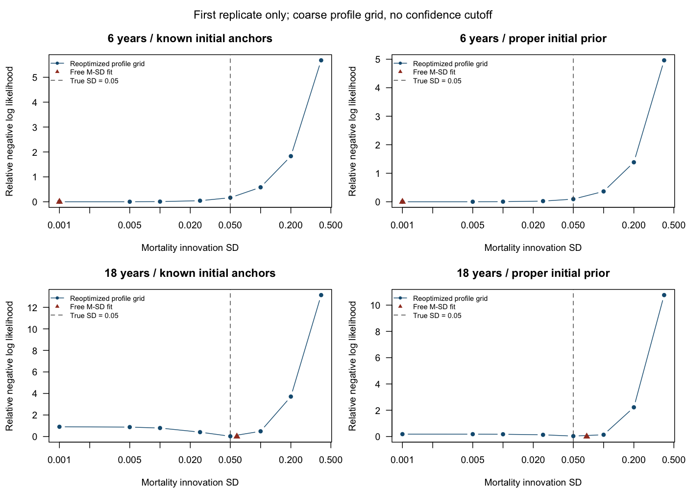

# Longer-series and mortality-SD profile pilot

Run from the repository root:

```sh
Rscript tests/integration/process-recovery/run-sensitivity.R /tmp/fims-process-sensitivity 3
Rscript tests/integration/process-recovery/plot-sensitivity.R /tmp/fims-process-sensitivity
```

Production/initial benchmark revision: `1cffc3e`. Source checksums, session and
configuration are retained in `configuration.R`. The original recovery benchmark
and its earlier five-replicate pilot remain unchanged. This experiment uses the
same local FIMS build (through `053646a`), R 4.4.3 and TMB 1.9.20 on Apple ARM64.

The experiment generated three datasets each at 6 and 18 years. Every joint
recruitment/F/M model used common SD starting values 0.025, 0.1 and 0.35, with
known initial anchors or proper initial priors. Dataset 1 at each horizon also
used eight fixed mortality-SD profile points, each with nuisance covariance
parameters and all latent states reoptimized from all three starts.

## Findings

All 132 attempts returned finite results without caught exceptions. Of these,
129 passed the declared optimizer checks. Two attempts slightly exceeded the
0.001 projected-gradient threshold; one returned singular-convergence code 1.
These attempts remain in `attempts.csv`. Each of the 44 free/profile cases had
at least two valid starts. Among valid starts, the largest within-case objective
spread was 0.0000384 NLL units. This does not prove global optimality, but it gives
little evidence that materially better solutions were missed by these starts.

Best free mortality innovation SDs (true value 0.05) were:

| Horizon | Initial information | Dataset 1 | Dataset 2 | Dataset 3 |
|---|---|---:|---:|---:|
| 6 years | Known first-year anchors | 0.001 | 0.243 | 0.0660 |
| 6 years | Proper first-year prior | 0.001 | 0.001 | 0.00128 |
| 18 years | Known first-year anchors | 0.0581 | 0.001 | 0.001 |
| 18 years | Proper first-year prior | 0.0680 | 0.001 | 0.001 |

The lower bound is 0.001; 0.00128 is near that bound but is not flagged by the
strict log-distance boundary rule. Similar likelihoods at differing very small
SDs are consistent with a flat region, not precisely determined small variances.

For dataset 1, the reoptimized profile showed:

| Horizon | Initial information | Relative NLL at SD 0.001 | Relative NLL at true SD 0.05 |
|---|---|---:|---:|
| 6 years | Known first-year anchors | 0.000 | 0.163 |
| 6 years | Proper first-year prior | approximately 0 | 0.092 |
| 18 years | Known first-year anchors | 0.905 | 0.022 |
| 18 years | Proper first-year prior | 0.181 | 0.032 |



The longer first dataset has an interior optimum near truth, but its lower-bound
likelihood remains close, especially with proper initial uncertainty. In the
other two longer datasets, estimates still collapse to the lower bound. Thus
tripling the series length did not consistently resolve variance estimation in
this small experiment. The profiles show relative support only: no regular
chi-square cutoff, confidence interval or coverage claim is attached.

The likelihood agreement across starts and the broad profile are evidence of
weak variance information in these datasets. They are not a proof of structural
nonidentifiability or evidence that a particular covariance structure is correct.
The horizons use different, non-nested trajectories despite matching seed labels,
and three replicates cannot establish a reliable boundary frequency.

Median fit times were 0.863 seconds at 6 years and 4.517 seconds at 18 years;
summed measured fit time was 360.463 seconds. These fits omit `sdreport` and
covariance inversion. Timings include initialization, optimization and mode
diagnostics, but exclude simulation, GC, writing and plotting. Maximum latent
dimension was 251. This is a local timing comparison, not a scalability claim.

Validation passed 9 tests / 51 assertions, including both benchmark integration
checks, projected-gradient logic, failed-attempt accounting and equivalence of
mapped/free integrated objectives at matching covariance values. The PNG was
rendered and visually inspected. Plotting uses native Quartz on macOS, avoiding
this machine's unavailable X11/Cairo libraries. No production code or new
dependency was introduced.

Next: compare observation-information designs and sensitivity to process SDs,
then compare scientifically motivated mortality structures. The current evidence
does not justify adding unrestricted age covariance as a remedy for unstable
SD estimation. Larger replication and additional covariance/latent starts are
needed before operational recommendations.

`attempts.csv` retains all starting-point outcomes and `best.csv` retains selected
cases and profile deltas. Full operating truth/data and replicate checkpoints
are regenerated as RDS files in the output directory and are not committed.
